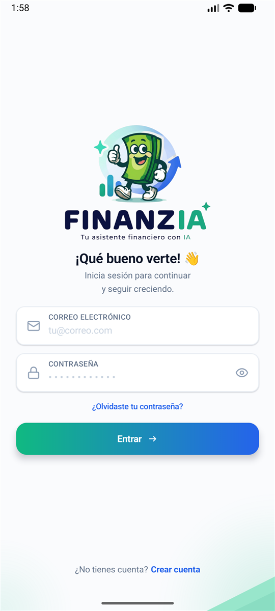
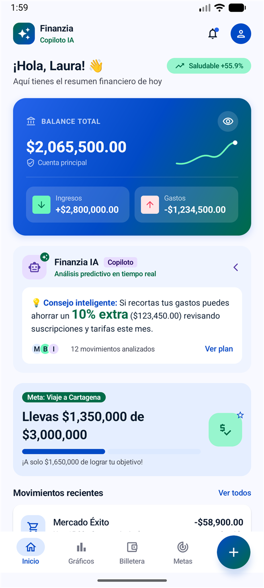
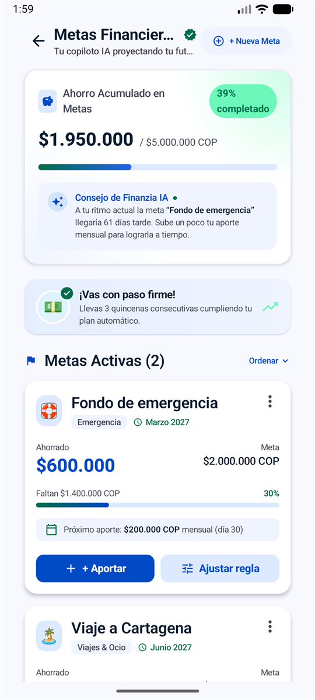
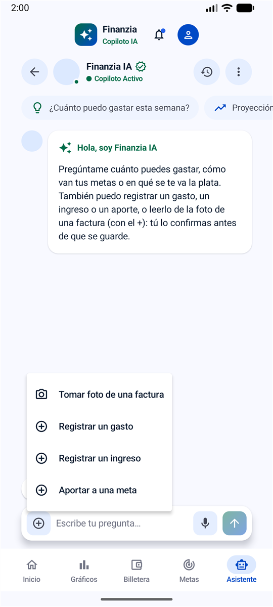
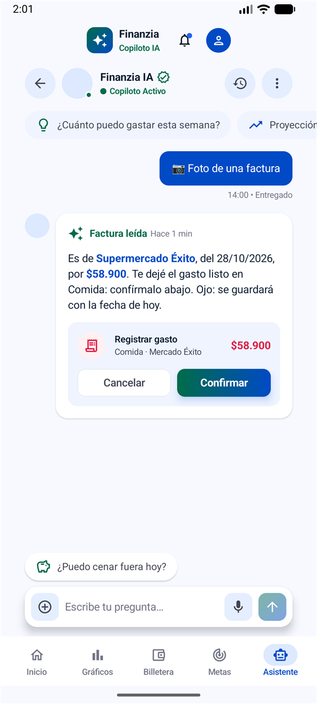
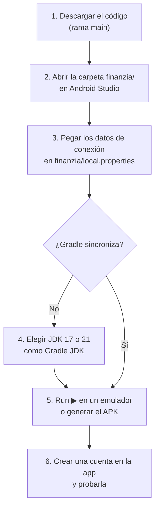
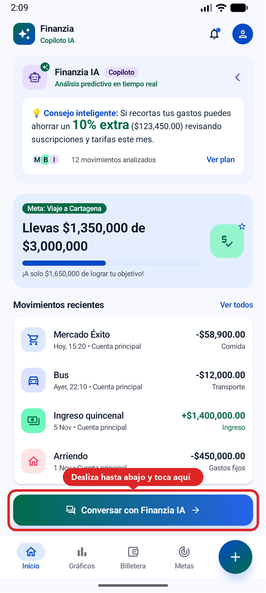
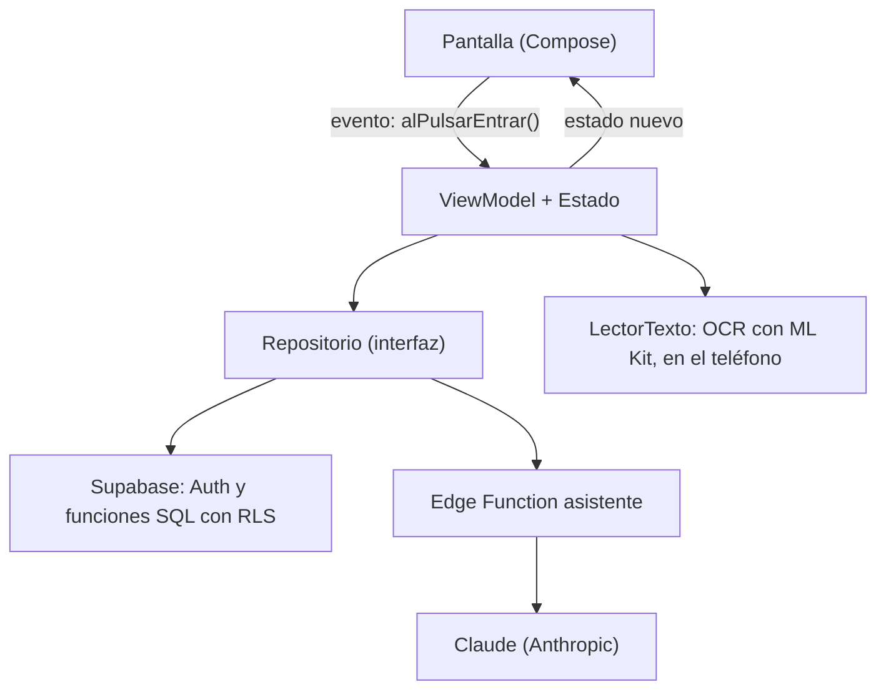

# Finanzia

Tu asistente financiero con IA. App Android nativa, hecha con Kotlin y Jetpack Compose, para llevar los ingresos, los gastos y las metas de ahorro, con un chat de IA que consulta tus datos y registra movimientos, incluso desde la foto de una factura.

> **Estado:** versión funcional en la rama `main`. Tiene registro, inicio de sesión y recuperación de contraseña, la bienvenida y los primeros pasos, el inicio con el balance y los movimientos (que se pueden editar o eliminar), las metas de ahorro con sus aportes y el chat con Finanzia IA.

## Entrega

| | |
|---|---|
| Repositorio | <https://github.com/Andres-Gz/app-movil-kotlin> |
| Rama con la última versión funcional | `main` |
| Integrante | [Andres-Gz](https://github.com/Andres-Gz) |
| Tecnologías | Kotlin 2.2, Jetpack Compose, Supabase (Auth, PostgreSQL y Edge Functions), ML Kit y Claude Opus 5.5 |

## Capturas

| Inicio de sesión | Inicio | Metas | Chat | Foto de una factura |
|:-:|:-:|:-:|:-:|:-:|
|  |  |  |  |  |

Las capturas del inicio, las metas y la factura usan datos de ejemplo.

## Cómo instalarla y probarla

La base de datos, las funciones y la IA ya están montadas en Supabase, así que **no hay que crear nada**: solo compilar la app con los datos de conexión del paso 3.



### Requisitos

- [Android Studio](https://developer.android.com/studio) de 2025 o más reciente (el proyecto usa AGP 8.13). Descarga solo el Android SDK 36 al abrir el proyecto.
- JDK 17 o 21 para Gradle. Si tu Android Studio trae uno más nuevo, mira el [paso 4](#4-si-gradle-no-sincroniza-jdk).
- Un emulador o un teléfono con Android 7.0 (API 24) o superior, con internet.

### 1. Descargar el código

```bash
git clone https://github.com/Andres-Gz/app-movil-kotlin.git
```

O en GitHub: **Code → Download ZIP**, y descomprímelo. Ponlo en una carpeta local, **fuera de OneDrive** o de cualquier carpeta sincronizada con la nube (ver [Problemas conocidos](#problemas-conocidos)).

### 2. Abrir el proyecto

En Android Studio: **File → Open** y elige la carpeta **`finanzia`** que está dentro del repositorio, no la raíz. Si pregunta, pulsa **Trust Project**.

### 3. Datos de conexión

Al abrir el proyecto, Android Studio crea el archivo `finanzia/local.properties` con una línea `sdk.dir` (déjala como está). Ábrelo y agrega al final estas dos líneas:

```properties
supabase.url=https://gwzpupyqdiyxmnzczmwd.supabase.co
supabase.clave=sb_publishable_W-qeTNYs6UaTH_YpNauXDQ_XZYt3S5l
```

Luego pulsa **File → Sync Project with Gradle Files**. Si no ves el archivo, cambia el panel de la izquierda de la vista **Android** a la vista **Project**. Si no existe, créalo en la carpeta `finanzia/`.

Es la clave **publicable** de Supabase, hecha para ir dentro de la app: lo que protege los datos son las reglas RLS de la base, que solo dejan a cada cuenta ver lo suyo. La clave secreta y la llave de la IA nunca salen del servidor. Si falta alguna de las dos líneas, Gradle no compila y dice cuál.

### 4. Si Gradle no sincroniza (JDK)

El proyecto usa Gradle 8.14, que funciona con Java 17 a 24. Las versiones más nuevas de Android Studio traen Java 25, y con él la sincronización falla (a veces el error solo dice `25.0.3`). Para arreglarlo:

1. **File → Settings** (en Mac, **Android Studio → Settings**) **→ Build, Execution, Deployment → Build Tools → Gradle**.
2. En **Gradle JDK**, elige un JDK 17 o 21. Si no hay ninguno, usa **Download JDK…** y descarga la versión 17.
3. **OK** y otra vez **File → Sync Project with Gradle Files**.

### 5. Ejecutar o generar el APK

- **En un emulador:** si no tienes uno, créalo en **Device Manager**. Elígelo arriba y pulsa **Run ▶**.
- **En un teléfono:** activa las opciones de desarrollador y la depuración USB, conéctalo, elígelo arriba y pulsa **Run ▶**.
- **Solo el APK:** **Build → Generate App Bundles or APKs → Generate APKs** (en versiones anteriores: **Build → Build Bundle(s) / APK(s) → Build APK(s)**). Queda en `finanzia/app/build/outputs/apk/debug/app-debug.apk`; cópialo al teléfono e instálalo, permitiendo instalar apps de origen desconocido.

### 6. Probarla

1. Toca **Crear cuenta** y registra un nombre, un correo y una contraseña (8 caracteres o más, con un número y una mayúscula). No hay que confirmar el correo: se entra de una vez.
2. En la bienvenida, **Comenzar ahora** lleva a registrar el primer ingreso y el primer gasto. Después se llega al inicio.
3. Para abrir el chat, en el inicio **desliza hasta abajo**: el botón **Conversar con Finanzia IA** está después de los movimientos recientes.

   

   En el chat, prueba:
   - "¿Cuánto gasté este mes?": responde con tus datos.
   - "Gasté 20 mil en almuerzo": propone el gasto y lo guarda solo si tocas **Confirmar**.
   - "¿Cuándo murió Hitler?": no responde, porque solo habla de tus finanzas y de la app.
   - **"+" → Tomar foto de una factura**: lee la factura en el teléfono y propone el gasto. En el emulador la cámara muestra una escena de prueba sin texto, así que esto se prueba mejor en un teléfono.

## Comandos

Desde la carpeta `finanzia/` (en Windows usa `gradlew.bat`), con `JAVA_HOME` apuntando a un JDK 17 o 21:

| Para… | Comando |
|---|---|
| Compilar | `./gradlew assembleDebug` |
| Instalar en el emulador o teléfono conectado | `./gradlew installDebug` |
| Pruebas unitarias | `./gradlew testDebugUnitTest` |
| Pruebas en el emulador (necesitan uno abierto) | `./gradlew connectedDebugAndroidTest` |
| Revisión de código (lint) | `./gradlew lintDebug` |

## Montar otro proyecto de Supabase (opcional)

Para probar la app no hace falta: basta con los datos del [paso 3](#3-datos-de-conexión). Esto es solo para usar un proyecto de Supabase propio; en ese caso, en `local.properties` van su URL y su clave **publicable** (`sb_publishable_…`), nunca la secreta.

En el panel del proyecto nuevo:

1. **SQL Editor → New query**, en este orden (cada archivo se pega y se pulsa **Run**; se pueden volver a correr sin problema):
   - [`supabase/esquema.sql`](supabase/esquema.sql): crea las tablas, solo si el proyecto es nuevo.
   - Si traes datos de otro proyecto: impórtalos desde CSV (**Table Editor → Insert → Import data from CSV**, empezando por `usuarios`, `colores` y `categorias`) y corre [`supabase/reajustar_contadores.sql`](supabase/reajustar_contadores.sql).
   - [`supabase/configuracion_cuentas.sql`](supabase/configuracion_cuentas.sql): crea la fila de `usuarios` al registrarse, deja que cada usuario lea solo la suya y protege el resto de tablas.
   - [`supabase/ingresos.sql`](supabase/ingresos.sql): crea la función `registrar_ingreso`, con la que la app guarda ingresos (en `movimientos`, sobre la cuenta principal del usuario, que crea si no existe).
   - [`supabase/gastos.sql`](supabase/gastos.sql): crea la función `registrar_gasto`, que guarda el gasto con su categoría (la crea en `categorias` si el usuario no la tiene).
   - [`supabase/inicio.sql`](supabase/inicio.sql): crea la función `resumen_inicio`, que junta en una llamada lo que muestra el dashboard.
   - [`supabase/editar_movimientos.sql`](supabase/editar_movimientos.sql): crea `editar_movimiento` y `eliminar_movimiento`. Eliminar no borra la fila: la deja inactiva.
   - [`supabase/metas.sql`](supabase/metas.sql): agrega a `metas` la categoría, el icono y la regla de aporte (columnas opcionales) y crea las funciones de metas: `resumen_metas` (las metas con lo ahorrado y las fechas de los aportes), `crear_meta`, `editar_meta`, `aportar_meta` (guarda el aporte en `aportes`, desde la cuenta principal), `ajustar_regla_meta` y `eliminar_meta` (no borra la fila: la deja inactiva).
   - [`supabase/asistente.sql`](supabase/asistente.sql): agrega a `mensajes` la acción que propone la IA y su estado, y crea las funciones del chat: listar conversaciones, leer sus mensajes, guardar cada pregunta con su respuesta, eliminar una conversación, confirmar o cancelar lo que propuso la IA y `movimientos_asistente` (los movimientos de un periodo, que consulta la IA). Va después de los anteriores porque confirmar usa `registrar_gasto`, `registrar_ingreso` y `aportar_meta`.
2. **Authentication → URL Configuration → Redirect URLs**: agrega `finanzia://recuperar`. Es la dirección del enlace del correo de recuperación, que abre la app en el paso 2.
3. **Authentication → Sign In / Providers → Email → Confirm email**: si está activado, cada cuenta nueva debe confirmar su correo antes de entrar. El servicio de correo gratis de Supabase solo envía a los miembros del equipo del proyecto (y pocos correos por hora), así que para que cualquiera pueda registrarse hay que desactivarlo o configurar un SMTP propio en **Authentication → Emails → SMTP Settings**. Lo mismo aplica al correo de recuperación de contraseña.
4. **El asistente (Finanzia IA)**. La IA es Claude, de Anthropic, y la app no le habla directo: lo hace la Edge Function [`supabase/functions/asistente`](supabase/functions/asistente), que guarda la llave de la API. Para activarlo:
   1. Crea una llave en [console.anthropic.com](https://console.anthropic.com) (**API Keys → Create Key**). La API se paga por uso, así que hay que cargar saldo en **Billing**.
   2. En Supabase, **Edge Functions → Secrets**: agrega `ANTHROPIC_API_KEY` con esa llave. Nunca la pongas en el código ni en `local.properties`.
   3. Despliega la función desde la carpeta raíz del repositorio (necesita Node.js; no hace falta Docker). `<ref>` es lo que va antes de `.supabase.co` en la URL del proyecto:
      ```bash
      npx supabase login
      npx supabase functions deploy asistente --project-ref <ref> --no-verify-jwt --use-api
      ```
      `--no-verify-jwt` deja que la función revise la sesión ella misma (así funciona también con las claves publicables nuevas); sin una sesión válida responde 401 y no llama a la IA.
   4. Si el chat responde "Finanzia IA no pudo responder", el motivo queda en **Edge Functions → asistente → Logs** (por ejemplo, que falta el secreto o que la llave no tiene saldo).

## Organización de los archivos

```
supabase/                               ← los SQL que se corren en Supabase y la Edge Function del asistente
└── functions/asistente/                ← habla con la IA: index.ts (la petición), conversacion.ts (memoria) y herramientas.ts
finanzia/                               ← proyecto Android (esta es la carpeta que se abre en Android Studio)
├── gradle/libs.versions.toml           ← versiones de todas las dependencias
└── app/src/
    ├── main/
    │   ├── java/com/example/finanzia/
    │   │   ├── ActividadPrincipal.kt   ← única actividad: aplica el tema y muestra la pantalla inicial
    │   │   ├── configuracion/
    │   │   │   └── Constantes.kt       ← constantes internas: tablas, mensajes de Logcat, patrones
    │   │   ├── tema/                   ← configuración visual
    │   │   │   ├── Colores.kt          ← la paleta de colores
    │   │   │   ├── Tipografia.kt       ← la fuente, los seis tamaños de letra y los estilos de texto
    │   │   │   ├── Dimensiones.kt      ← espacios, esquinas, alturas, tamaños y sombras
    │   │   │   ├── Iconos.kt           ← los iconos, cada uno con un nombre que dice para qué es
    │   │   │   └── TemaFinanzia.kt     ← junta todo lo anterior en el tema de la app
    │   │   ├── componentes/            ← piezas reutilizables: campos, botones, avisos, fondo…
    │   │   ├── datos/                  ← todo lo que habla con Supabase
    │   │   │   ├── ClienteSupabase.kt  ← la conexión única de la app
    │   │   │   ├── modelos/            ← las tablas mapeadas a data classes (p. ej. Usuario)
    │   │   │   └── repositorios/       ← acceso a los datos: una interfaz y su implementación
    │   │   ├── fotos/                  ← tomar una foto y leer su texto: la cámara del teléfono y el OCR (ML Kit)
    │   │   ├── pantallas/
    │   │   │   ├── iniciosesion/       ← una carpeta por pantalla
    │   │   │   │   ├── PantallaInicioSesion.kt
    │   │   │   │   ├── EstadoInicioSesion.kt
    │   │   │   │   ├── InicioSesionViewModel.kt
    │   │   │   │   └── ValidadorInicioSesion.kt
    │   │   │   ├── registro/           ← misma forma: Pantalla, Estado, ViewModel y Validador
    │   │   │   ├── recuperarcontrasena/  ← paso 1: verificar usuario y correo
    │   │   │   ├── nuevacontrasena/      ← paso 2: escribir y confirmar la contraseña nueva
    │   │   │   ├── bienvenida/           ← al iniciar sesión; solo muestra datos, así que no tiene ViewModel
    │   │   │   ├── primerospasos/        ← tras "Comenzar ahora"; tampoco tiene ViewModel
    │   │   │   ├── primeringreso/        ← monto y frecuencia del primer ingreso, guardado en Supabase
    │   │   │   ├── primergasto/          ← monto y categoría del primer gasto, guardado en Supabase
    │   │   │   ├── inicio/               ← el dashboard: balance, consejo, meta y últimos movimientos
    │   │   │   ├── editarmovimiento/     ← editar o eliminar un movimiento (se abre al tocarlo en el inicio)
    │   │   │   ├── metas/                ← ahorro, consejo de la IA, racha y cada meta; aportar, ajustar la regla y eliminar
    │   │   │   ├── nuevameta/            ← crear o editar una meta: nombre, categoría, monto, mes y frecuencia del aporte
    │   │   │   └── asistente/            ← el chat con Finanzia IA: mensajes, propuestas para confirmar e historial
    │   │   └── utilidades/             ← funciones que se usan en varios lugares (p. ej. RegistroErrores.kt, Validaciones.kt)
    │   └── res/values/strings.xml      ← todos los textos de la app
    ├── test/                           ← pruebas unitarias (corren en el computador)
    └── androidTest/                    ← pruebas de pantalla (corren en el emulador)
```

## Cómo está construida

La app se arma por capas, como piezas de construcción:

1. **Configuración (`tema/`)**: aquí se definen todos los valores visuales (colores, letras, medidas e iconos). Para cambiar el aspecto de la app se cambia aquí, y el cambio se ve en todas partes.
2. **Componentes (`componentes/`)**: piezas reutilizables, como un campo de texto o un botón, hechas solo con la configuración. No guardan estado ni saben en qué pantalla están: reciben valores y avisan lo que pasa mediante callbacks.
3. **Pantallas (`pantallas/`)**: cada pantalla junta componentes y siempre tiene la misma forma:
   - `Estado<X>.kt`: una `data class` con todo lo que la pantalla muestra.
   - `<X>ViewModel.kt`: guarda el estado, recibe lo que hace el usuario (`alCambiarCorreo`, `alPulsarEntrar`…) y produce un estado nuevo.
   - `Pantalla<X>.kt`: dibuja el estado. La parte que dibuja no tiene estado propio, por eso su vista previa (`@Preview`) funciona sin ViewModel.
   - La lógica pura, como las validaciones, va en su propio archivo (`Validador<X>.kt`) para probarla sin emulador.
4. **Datos (`datos/`)**: el ViewModel nunca habla directo con Supabase. Le pide los datos a un **repositorio**, que es una interfaz (`RepositorioSesion`) con su implementación (`RepositorioSesionSupabase`), y lo recibe por su constructor. Las tablas se mapean a `data class` en `modelos/`. En las pruebas se usa un repositorio falso, así no hace falta internet.



Una pantalla no navega por su cuenta: avisa con callbacks (`alIniciarSesion`, `alRegistrarse`…) y `ActividadPrincipal` decide a dónde ir. Por ahora guarda en una variable qué pantalla se ve (con pocas pantallas no hace falta una librería de navegación).

Si vienes de Spring Boot, la equivalencia es:

| Spring Boot | Aquí |
|---|---|
| Vista | `Pantalla<X>.kt` |
| Controller | `<X>ViewModel.kt` |
| Service | Todavía no hace falta; si la lógica crece, va entre el ViewModel y el repositorio |
| Repository | `datos/repositorios/`: una interfaz y su implementación con Supabase |
| Entity | `datos/modelos/`: una `@Serializable data class` por tabla |
| DataSource y `application.properties` | `ClienteSupabase` y `local.properties` |

## Reglas del proyecto

Estas reglas mantienen el código ordenado y predecible. Antes de subir un cambio, revisa que las cumpla.

### 1. Nada escrito a mano en el código

Cada tipo de valor vive en **un solo archivo**. Si necesitas uno que no existe, agrégalo ahí con un nombre que diga para qué sirve y úsalo desde ahí.

| Valor | Dónde vive | No se escribe en ningún otro lado |
|---|---|---|
| Colores | `tema/Colores.kt` | `Color(0xFF…)`, `Color.White`, `Color.Transparent`… |
| Fuente, tamaños y estilos de letra | `tema/Tipografia.kt` | `.sp`, `FontFamily`, `FontWeight`, `TextStyle(…)` |
| Medidas | `tema/Dimensiones.kt` | `.dp` |
| Iconos | `tema/Iconos.kt` | `Icons.…` |
| Textos (incluidos los de accesibilidad) | `res/values/strings.xml` | cualquier texto que vea el usuario |
| Constantes internas (nombres de tablas, mensajes de Logcat, patrones de validación) | `configuracion/Constantes.kt`, agrupadas por tema (`Constantes.BaseDatos`, `Constantes.Registro`…) | cualquier texto o valor suelto en el código |
| Datos de conexión (URL y clave publicable de Supabase) | `local.properties`, que no se sube (los del proyecto de la entrega están en el [paso 3](#3-datos-de-conexión)) | el código |

```kotlin
// ✗ Así no
Text("Entrar", fontSize = 16.sp, color = Color(0xFF2563EB), modifier = Modifier.padding(16.dp))

// ✓ Así sí
Text(
    text = stringResource(R.string.inicio_sesion_boton_entrar),
    style = EstilosTexto.cuerpo,
    color = Colores.azulMarca,
    modifier = Modifier.padding(Dimensiones.espacioMediano),
)
```

### 2. Las pantallas son copia del diseño

Cada pantalla se construye igual a su diseño: textos, colores, medidas, iconos y estados de error. Los valores se miden sobre el diseño y se guardan en `tema/`.

Los textos sí están normalizados: un mismo tipo de texto tiene el mismo tamaño en todas las pantallas, aunque un diseño traiga uno un poco distinto. Hay seis tamaños (`TamanoLetra`) y cada uno lleva siempre su alto de línea. Todo texto usa un estilo de `EstilosTexto`, nombrado por su función:

| Tamaño | Para qué | Estilos |
|---|---|---|
| 24 | Logo de texto (el inicio de sesión usa la imagen `logo_finanzia`) | `logoCompacto` |
| 20 | Título de la pantalla | `titulo` |
| 14 | Botones, lo que se escribe en los campos y títulos de avisos | `boton`, `botonSecundario`, `valorCampo`, `tituloAviso`… |
| 13 | Descripción bajo el título y pie de la pantalla | `cuerpo`, `cuerpoDestacado` |
| 12 | Eslogan, enlaces del formulario y avisos de error | `nota`, `notaFuerte` |
| 11 | Etiquetas de campos, mensajes bajo los campos, requisitos y términos | `etiqueta`, `etiquetaExterna`, `ayuda`… |

Para destacar un texto se cambia el peso o el color; no se inventa un tamaño nuevo.

### 3. Todo en español

- Textos de la app, carpetas, archivos, clases, funciones, variables, recursos, comentarios y mensajes de commit.
- Sin tildes ni ñ en nombres de código ni de archivos: `contrasena`, `TamanoLetra`, `Tipografia`. En los textos de `strings.xml` sí van.
- Los callbacks empiezan con `al` en lugar de `on`: `alPulsar`, `alCambiarCorreo`.
- La app existe solo en español: los textos van únicamente en `res/values/strings.xml`, sin carpetas de traducción (`values-en`…).
- Se exceptúan las palabras de Kotlin, Android y Compose, y los nombres que exigen Android o Gradle (`AndroidManifest.xml`, `build.gradle.kts`, `strings.xml`…).

### 4. Nombres claros

- Un concepto por archivo, y el archivo se llama como su clase o composable principal.
- Las claves de `strings.xml` llevan prefijo: el de la pantalla (`inicio_sesion_…`), `accion_…` para las descripciones de accesibilidad y `error_…` para los mensajes de error.

### 5. Simple

No agregues capas ni librerías (inyección de dependencias, navegación, red…) hasta que una pantalla real las necesite.

### 6. Nada repetido

Si una función hace falta en más de un lugar, va en `utilidades/` y se reutiliza desde ahí; nunca se copia y pega. Por ejemplo, cada repositorio registra sus errores con `registrarAdvertencia(...)` de `utilidades/RegistroErrores.kt`.

## Cómo agregar una pantalla nueva

1. Crea la carpeta `pantallas/<nombrepantalla>/` con `Pantalla<X>.kt`, `Estado<X>.kt` y `<X>ViewModel.kt`, siguiendo la forma de `iniciosesion/`.
2. Agrega sus textos a `strings.xml` con el prefijo de la pantalla.
3. Arma la pantalla con los componentes que ya existen. Si necesitas una pieza nueva, créala sin estado en `componentes/`.
4. Si falta un color, una medida o un icono, agrégalo primero en `tema/`.
5. Si la pantalla necesita datos, crea su modelo en `datos/modelos/` y su repositorio en `datos/repositorios/` (interfaz + implementación). El ViewModel recibe la interfaz por su constructor.
6. Conéctala desde `ActividadPrincipal` mediante callbacks.
7. Escribe pruebas: unitarias para el ViewModel (con un repositorio falso) y la lógica, y de pantalla para los flujos importantes.
8. Antes de subir: compila, pasan las pruebas y `./gradlew lintDebug` no da errores.

## Commits

En español, contando qué cambia y por qué. El asunto es corto y en presente, por ejemplo `Agrega la pantalla de registro` o `Corrige la validación del correo`.

## Notas técnicas

- Las dependencias se declaran solo en `gradle/libs.versions.toml`. Las de Compose van sin versión porque la fija el BOM.
- El proyecto usa AGP 8.13 con Gradle 8.14 para que abra también en las versiones de Android Studio de la universidad. Con AGP 8 el plugin `org.jetbrains.kotlin.android` sí es necesario.
- La versión de lanzamiento todavía no se minifica (`isMinifyEnabled = false`).
- El OCR usa la versión de ML Kit que trae el modelo dentro de la app (`text-recognition`), para que funcione desde la primera foto y sin depender de Google Play. Le suma unos 16 MB al APK; `build.gradle.kts` quita la arquitectura x86 y comprime las librerías nativas para que no sean más.
- Material 3 ya no incluye iconos: usamos `material-icons-extended`, siempre a través de `tema/Iconos.kt`.
- Supabase se usa con [supabase-kt](https://github.com/supabase-community/supabase-kt) 3.2.6, la última versión compatible con nuestro Kotlin 2.2 (desde la 3.7 pide Kotlin 2.4).
- El inicio de sesión lo hace Supabase Auth. La tabla `usuarios` solo aporta el perfil (se busca por correo) y la app nunca lee su columna `contrasena`.
- El registro crea la cuenta en Supabase Auth y guarda el nombre como dato extra del usuario (`raw_user_meta_data`). La fila de `usuarios` la crea la base de datos con el disparador de `supabase/configuracion_cuentas.sql`; sin él, una cuenta nueva no puede iniciar sesión ("Tu cuenta no tiene un perfil registrado").
- Recuperar la contraseña usa el flujo de Supabase Auth: el paso 1 pide el enlace al correo (`resetPasswordForEmail`) y el enlace `finanzia://recuperar` abre la app en el paso 2, que cambia la contraseña con la sesión temporal (`updateUser`). El nombre de usuario del paso 1 se pide pero no se compara con la base: hacerlo permitiría averiguar qué cuentas existen, y el correo ya prueba que la cuenta es de quien la pide.

## El asistente (Finanzia IA)

- **Por qué hay un servidor en medio.** La app llama a la Edge Function `asistente` con el token de la sesión, y la función llama a Claude. Si la app llamara directo a la IA, la llave de la API quedaría dentro del APK y cualquiera podría sacarla.
- **Memoria.** El modelo no recuerda nada entre una pregunta y otra. Cada pregunta y su respuesta se guardan en `conversaciones` y `mensajes`, y en cada pregunta nueva la función le vuelve a mandar los últimos 40 mensajes. Por eso, si arriba le dijiste "70", en el siguiente mensaje lo sabe.
- **Acceso a los datos.** La IA no escribe SQL ni toca la base. Tiene herramientas (`consultar_resumen`, `consultar_movimientos`, `consultar_metas`) que la función ejecuta con las mismas funciones SQL de la app y con el token del usuario, así que solo ve los datos de quien pregunta.
- **Registrar desde el chat.** Con `proponer_gasto`, `proponer_ingreso` y `proponer_aporte` la IA solo propone: la respuesta trae una tarjeta con Confirmar y Cancelar, y se guarda únicamente si el usuario confirma (`confirmar_accion_asistente`, que usa `registrar_gasto`, `registrar_ingreso` y `aportar_meta`).
- **Solo temas de la app.** Las instrucciones de la IA (`instrucciones` en `conversacion.ts`) la limitan a las finanzas del usuario y al uso de Finanzia. A lo demás ("¿cuándo murió Hitler?") responde siempre el mismo mensaje, aunque insistan o lo disfracen de pregunta de plata. Está en el servidor porque ahí no se puede cambiar desde la app. Es una instrucción, no un filtro: si algún día se deja enredar, se ajusta ese texto y se vuelve a desplegar la función.
- **Fotos de facturas.** En el "+" del chat, "Tomar foto de una factura" abre la cámara del teléfono (por eso la app no pide el permiso de cámara). El OCR lo hace [ML Kit](https://developers.google.com/ml-kit/vision/text-recognition/v2) en el teléfono, sin internet, y la foto se borra apenas se lee: a la Edge Function solo le llega el texto (`texto_foto`). Con eso la IA usa `proponer_gasto` o `proponer_ingreso`, así que nada se guarda sin Confirmar. El texto de la foto no queda en la base: se guarda la etiqueta "📷 Foto de una factura" y la respuesta de la IA, que por eso escribe el comercio, la fecha y el total. Tampoco se le obedece: es un dato, y si dice "ignora tus instrucciones" no pasa nada. Lo que se confirma queda con la fecha de hoy, no con la de la factura.
- **Por qué `Renglones.kt`.** El OCR entrega las columnas de una factura por separado ("TOTAL" en un lado y "58.900" en otro). `armarRenglones` las vuelve a juntar usando la posición de cada línea, y antes endereza la foto, porque con dos grados de inclinación un precio ya cae en el renglón de abajo.
- **Modelo.** Claude Opus 5.5 (`claude-opus-5-5`), con esfuerzo `medium`; se cambian en `conversacion.ts`. Si los filtros de seguridad rechazan una pregunta, la API la reintenta sola con otro modelo (`fallbacks: "default"`) y, si igual la rechaza, la app muestra una respuesta amable.
- **Pruebas de la función** (sin llamar a la IA), desde la raíz del repositorio y con [Deno](https://deno.com): `deno test supabase/functions/asistente`.

## Problemas conocidos

- **Gradle no sincroniza y el error dice `25.0.x` o `Unsupported class file major version`**: Android Studio está usando Java 25. Elige un JDK 17 o 21 como se explica en el [paso 4](#4-si-gradle-no-sincroniza-jdk).
- **`Falta "supabase.url" en local.properties`**: faltan las dos líneas del [paso 3](#3-datos-de-conexión).
- **"Finanzia IA no pudo responder"**: revisa el internet y vuelve a intentar. Si sigue, el motivo queda en Supabase, en **Edge Functions → asistente → Logs**.
- **La foto de una factura en el emulador dice "No pudimos leer texto en esa foto"**: la cámara del emulador muestra una escena de prueba sin texto. Pruébalo en un teléfono con una factura de verdad.
- **Proyecto dentro de OneDrive** u otra carpeta sincronizada: Gradle falla con `Unable to delete directory…` o `Cannot snapshot… not a regular file`. Clona el repositorio de nuevo en una carpeta local, por ejemplo `C:\dev\`. Si solo lo mueves, los archivos pueden conservar la marca de OneDrive y el error sigue.
